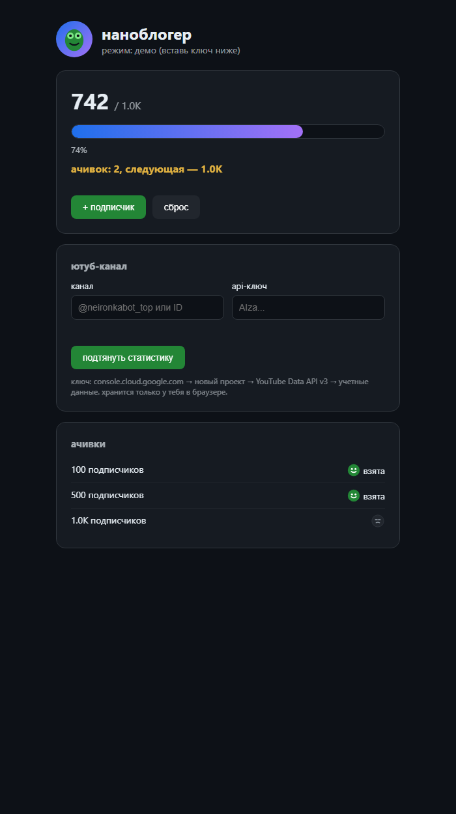

# w2-nanobloger — бар до ачивки с живыми цифрами ютуба

Проект 2 из web-серии: progress-bar + HTML.
Ванилла без библиотек, открывается двойным кликом.

## что умеет

- демо-режим: кнопка +1 двигает бар, сброс, все в localStorage
- live-режим: канал + api-ключ → подписчики, просмотры, число видео, свежее видео с лайками
- бар и ачивки (100/500/1000) едут от реальных цифр, опрос раз в минуту
- ключ хранится только в браузере, в код и репозиторий не попадает
- кастомные svg-смайлы вместо системных, аватар-ящерка
- канвас-ящерка догоняет курсор + 3д-наклон карточек (откл. при prefers-reduced-motion)

## ключ за 2 минуты

console.cloud.google.com → новый проект → YouTube Data API v3 включить →
учетные данные → скопировать ключ → вставить в форму. квоты 10к/день, опрос ест ~3.

## проверка логики

`node A:\TEMP\w2_check.js` — `logic ok` (ступени, проценты, fmt, разбор канала).

## скрин

